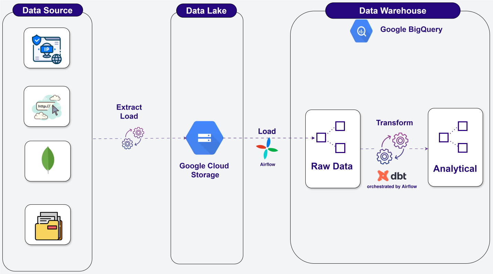

# Glamira Analytics Pipeline

End-to-end batch pipeline for 41.4M e-commerce events from Glamira, a jewelry retailer with 86 country websites. The data moves from MongoDB through a GCS data lake into BigQuery, where dbt builds a star schema, and Airflow orchestrates it with one task per dbt model.

> **Stack:** Python · MongoDB · Google Cloud (Compute Engine, Cloud Storage, BigQuery) · dbt · Airflow + Cosmos · Docker · Terraform



---

## Highlights

- **41.4M events → 34,995 order lines → $20.1M revenue in USD**, converted from 41 local currencies
- **Star schema:** `fact_sales_order_detail` plus 6 dimensions (date, product, store, location, customer, device)
- **59 dbt tests**, covering unique keys, not-null columns and fact → dim relationships. Every fact key resolves to a dimension row.
- **Airflow with Cosmos:** each dbt model and its tests are separate Airflow tasks, so a failure retries one model, not the whole build
- **Idempotent runs:** loads use `WRITE_TRUNCATE` and models are full rebuilds, so reruns never double-count
- **Infrastructure as code:** Terraform provisions the VPC, the VM (IAP SSH only, no public ports), a service account, the bucket and the `raw` dataset. dbt creates the other datasets.

## Pipeline

| Step | What happens | Code |
|---|---|---|
| 1. Ingest | Restore the BSON dump into MongoDB on a GCE VM | [`vm/setup_mongodb.sh`](vm/setup_mongodb.sh), [`extract/import_events.sh`](extract/import_events.sh) |
| 2. Enrich | Crawl 19,417 product pages; geolocate 3.2M IPs with IP2Location | [`extract/crawl_products.py`](extract/crawl_products.py), [`extract/lookup_ips.py`](extract/lookup_ips.py) |
| 3. Export | MongoDB → Parquet in GCS at `export/<table>/<run_id>/`, with a `_SUCCESS` marker written last | [`extract/mongo_to_gcs.py`](extract/mongo_to_gcs.py) |
| 4. Load | Find the newest complete run per table → BigQuery `raw` | [`airflow/dags/glamira_pipeline.py`](airflow/dags/glamira_pipeline.py) (fallback: [`load/gcs_to_bq.sh`](load/gcs_to_bq.sh)) |
| 5. Transform | dbt builds staging → intermediate → marts, with tests after each model | [`transform/`](transform/) |

## Data model

BigQuery datasets follow the dbt layers:

| Dataset | Models | Materialized as |
|---|---|---|
| `raw` | `summary`, `ip_locations`, `products` | loaded tables |
| `staging` | `stg_events`, `stg_products`, `stg_ip_locations` | views: typed and cleaned, 1:1 with source |
| `intermediate` | `int_order_items`: one row per order line, deduplicated, converted to USD | table |
| `seeds` | `currency` (store → ISO currency), `exchange_rates` | seed tables |
| `marts` | `fact_sales_order_detail`, `dim_date`, `dim_product`, `dim_store`, `dim_location`, `dim_customer`, `dim_device` | tables |

The fact table has one row per order line (`order_id` + `line_number`):

| Kind | Columns |
|---|---|
| Keys | `date_key`, `product_key`, `store_key`, `location_key`, `customer_key`, `device_key` |
| Measures (USD) | `order_qty`, `unit_price_usd`, `sales_amount_usd` |
| Flag | `is_free_gift` |

## Design decisions

| Decision | Why |
|---|---|
| **GCS between MongoDB and BigQuery** | decouples source and warehouse; immutable `run_id` folders can be replayed; BigQuery loads from GCS are free and atomic |
| **`_SUCCESS` marker** | the loader only reads runs that finished, so a half-written export is never loaded |
| **Currency comes from the store, not the price symbol** | `kr` is SEK, DKK or NOK and `$` covers 4 currencies; the store's country domain gives one ISO code |
| **Surrogate keys with `FARM_FINGERPRINT`, plus `-1` "unknown" rows** | stable INT64 keys with no sequence table; every fact row joins to a dimension, including 5,988 free-gift lines whose products were never crawled |
| **`device_id` is the customer** | 95% of visitors never log in. Email stays in staging and is kept out of the marts (PII). |
| **dbt in its own venv inside the Airflow image** | dbt-bigquery and Airflow's Google provider pin conflicting `protobuf` versions; Cosmos calls the dbt binary as a subprocess |
| **`int_order_items` is a table** | it's read by 3 marts; as a view, each read re-scanned 41M events (4.1 GB → 2 MB per downstream build) |

## Data quality findings

Full results are in [`docs/profiling/bigquery.md`](docs/profiling/bigquery.md).

- **Prices are locale strings:** `1.356,00`, `1,069.00`, `7 423,00`, `61٫00` (Arabic decimal sign). The [`parse_price`](transform/macros/parse_price.sql) macro treats the last `.` or `,` before 2 digits as the decimal separator.
- **48 duplicate `checkout_success` events** share an `order_id`; the first one is kept.
- **17% of order lines reference products that were never crawled.** They're free-gift pendants priced at 0, flagged `is_free_gift`.
- **`local_time` isn't zero-padded** (`2020-05-25 1:7:25`), so it's parsed with `SAFE.PARSE_DATETIME`. Event time uses the UTC `time_stamp`.
- **Stores 24 and 78 are `glamira.local` test traffic**, mapped to the unknown store.

## Repository structure

```
├── terraform/   # VPC, VM, service account, bucket, BigQuery raw dataset
├── vm/          # MongoDB install script for the VM
├── extract/     # import, crawl, IP lookup, Mongo → GCS export (run on the VM)
├── load/        # manual GCS → BigQuery fallback, profiling queries
├── transform/   # dbt project: staging, intermediate, marts, seeds, tests
├── airflow/     # Docker Compose, custom image (Cosmos + dbt), DAG
├── docs/        # data dictionary, profiling results
└── images/      # architecture diagram
```

## Run it

Requirements: a GCP project, `gcloud`, Terraform, Docker and [uv](https://docs.astral.sh/uv/).

```bash
# 1. Infrastructure
cd terraform && terraform init && terraform apply -var project_id=<your-project>

# 2. On the VM (make ssh): MongoDB, data, enrichment, export
bash vm/setup_mongodb.sh
bash extract/import_events.sh
uv run extract/crawl_products.py
uv run extract/lookup_ips.py
uv run extract/mongo_to_gcs.py

# 3. On your machine: Airflow runs load + dbt
gcloud auth application-default login      # dbt and Airflow use this login (oauth)
cd airflow && docker compose up -d         # UI at http://localhost:8080 (airflow / airflow)
# trigger the glamira_pipeline DAG
```

To run dbt without Airflow: `cd transform && uv run dbt build`.

Use `make help` for VM shortcuts: `make vm-start`, `make vm-stop`, `make ssh`, `make tunnel`.

## Next steps

- **Dashboard:** Looker Studio on the marts (revenue by country, device and product)
- **CI:** `dbt build` against a CI dataset on every pull request
- **Production changes:** incremental extraction (CDC) from a MongoDB secondary instead of full exports; incremental dbt models for the event tables; daily exchange rates instead of the [approximate Q2 2020 averages](transform/seeds/exchange_rates.csv) used here; a GCS lifecycle rule to expire old export runs
